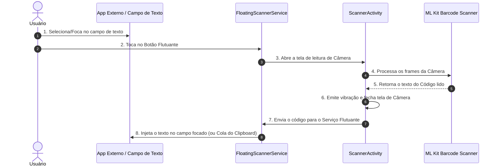

# Scanner

O **Scanner** é um aplicativo Android desenvolvido em Kotlin que oferece um leitor de código de barras e QR Codes sempre acessível através de um botão flutuante em sobreposição de tela (*overlay*). 

Com ele, o usuário pode escanear códigos diretamente de qualquer aplicativo (sistemas web, blocos de notas, ERPs, formulários) e o valor lido é **inserido automaticamente no campo de texto que estiver focado**.

---

## 🚀 Funcionalidades Principais

- **Botão Flutuante Drag-and-Drop**: Um botão flutuante sobreposto à tela que pode ser arrastado para qualquer posição.
- **Leitura Rápida e Precisa**: Integração com a câmera via CameraX e processamento em tempo real com Google ML Kit Barcode Scanning.
- **Injeção Automática de Texto**: Utiliza o Serviço de Acessibilidade do Android para digitar o código escaneado diretamente no campo focado (`EditText`, WebViews ou formulários).
- **Cópia de Segurança (Clipboard)**: Além da injeção direta, o código lido é copiado para a Área de Transferência.
- **Feedback Háptico**: Resposta por vibração suave ao detectar o código com sucesso.
- **Painel de Configuração e Status**: Tela principal intuitiva para gerenciamento do status das permissões e área de testes.

---

## 🛠️ Stack Tecnológica

| Tecnologia | Descrição |
| :--- | :--- |
| **Linguagem** | [Kotlin](https://kotlinlang.org/) |
| **Arquitetura UI** | Android Views & XML, Material Components |
| **Câmera** | [CameraX 1.4.0](https://developer.android.com/training/camerax) (`camera-core`, `camera-camera2`, `camera-view`) |
| **Processamento de Códigos** | [Google ML Kit Barcode Scanning 17.3.0](https://developers.google.com/ml-kit/vision/barcode-scanning) |
| **Serviço Flutuante & Injeção** | `AccessibilityService` + `WindowManager` (System Alert Window) |
| **Compatibilidade** | Android 8.0 (API 26) até Android 15 (API 37) |
| **Gerenciador de Build** | Gradle com Kotlin DSL (`build.gradle.kts`) |

---

## 🔄 Fluxo de Funcionamento



---

## 🔑 Permissões Necessárias

O aplicativo requer três permissões essenciais para pleno funcionamento:

1. **Câmera (`android.permission.CAMERA`)**: Necessária para capturar as imagens dos códigos de barras e QR Codes.
2. **Sobreposição de Tela (`android.permission.SYSTEM_ALERT_WINDOW`)**: Necessária para exibir o botão flutuante sobre outros aplicativos.
3. **Serviço de Acessibilidade (`android.permission.BIND_ACCESSIBILITY_SERVICE`)**: Necessário para identificar o campo de texto ativo e realizar a injeção do código lido.

---

## 📲 Como Usar

1. **Abra o aplicativo**: Na tela inicial, acesse o painel de configurações do **Scanner Flutuante**.
2. **Conceda as Permissões**:
   - Conceda a permissão de **Câmera**.
   - Conceda a permissão de **Sobreposição de Tela**.
   - Ative o **Serviço de Acessibilidade** nas configurações do dispositivo.
3. **Inicie o Leitor**:
   - O botão flutuante verde aparecerá na tela.
   - Abra qualquer aplicativo onde deseja inserir o código.
   - Clique no campo de texto onde deseja digitar.
   - Toque no botão flutuante e aponte para o código.
   - O valor será lido e preenchido automaticamente!

---

## 💻 Como Compilar o Projeto

### Pré-requisitos
- **Android Studio**: Ladybug (2024.2.1) ou superior.
- **JDK**: Java 11 ou 17.
- **Dispositivo Físico ou Emulador**: Android 8.0 (API 26) ou superior com câmera funcional.

### Passos
```bash
# 1. Clone este repositório
git clone https://github.com/seu-usuario/scanner-keyboard.git

# 2. Abra o projeto no Android Studio

# 3. Sincronize as dependências do Gradle

# 4. Execute o aplicativo no seu dispositivo Android (Shift + F10)
```

---

## 📂 Estrutura de Arquivos Principais

```text
app/src/main/
├── java/com/vuteq/scank/
│   ├── MainActivity.kt           # Tela principal de permissões e teste
│   ├── ScannerActivity.kt        # Tela de leitura da Câmera + ML Kit
│   └── FloatingScannerService.kt # Serviço flutuante + Injeção de texto via Acessibilidade
└── res/
    ├── layout/
    │   ├── activity_main.xml     # Layout do painel de permissões
    │   ├── activity_scanner.xml  # Layout da tela de mira do scanner
    │   └── floating_button_layout.xml # Layout do botão flutuante
    └── xml/
        └── accessibility_service_config.xml # Configuração do Serviço de Acessibilidade
```
